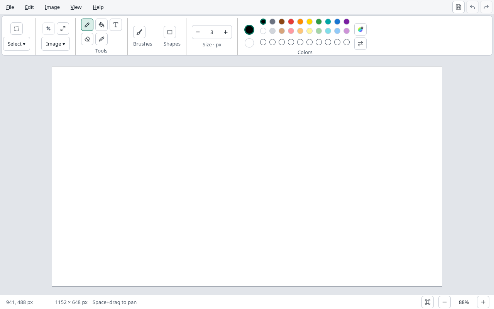

# OpenPaint

**The familiar joy of Paint. Built for Linux.**

OpenPaint is an independent, open-source desktop painting app inspired by modern
Microsoft Paint: quick sketches, easy image edits, and a canvas that gets out of
your way.

**First useful alpha: 0.1.0-alpha.1 · Linux x86_64**

[Download AppImage or Flatpak](https://github.com/AfshinKI/openpaint/releases/tag/v0.1.0-alpha.1) ·
[Install / update / remove](docs/INSTALL.md) · [Build from source](docs/BUILD.md)

Draw with brushes and fill, add shapes and text, select/copy/paste, crop and resize.
Open and export PNG, JPEG, BMP and WebP. Undo/redo, zoom/pan, light/dark themes,
and saved custom colors are included. Editing works offline without an account.

This is an early alpha. Layers, project files, crash recovery and automatic updates
come later. Keep copies of important originals. See [capabilities and limits](docs/FEATURES.md)
and [release validation](docs/plans/0027-alpha-release.md).



### What we're building

- Familiar drawing tools, shapes, text, selections, and color controls.
- Layers, transparency, editable projects, and dependable undo and recovery.
- A clean, accessible interface with light and dark themes.
- Linux downloads through Flatpak and AppImage, with an in-app Updates screen.
- Offline editing, no account requirement, and no telemetry. Optional AI tools come later.

### The plan

**C++20 · Qt 6 · QML · CMake · GPL-3.0-or-later**

Start with a small, reliable editor; build toward modern Paint's workflows in
testable stages. Feature parity is a goal, not a claim of current compatibility.

[Roadmap](docs/ROADMAP.md) · [Interface design](docs/DESIGN.md) ·
[Architecture](docs/ARCHITECTURE.md) · [Feature checklist](docs/FEATURES.md) ·
[Releases & updates](docs/RELEASES.md)

### Contribute

Start with [CONTRIBUTING.md](CONTRIBUTING.md). Documentation and tooling checks run
today with Python 3.11 or newer and Git:

```sh
python3 tools/check_repo.py
python3 -m unittest discover -s tools/tests -v
```

Codex, Claude Code, other coding assistants, and human contributors share the same
[project instructions](AGENTS.md) and [feature workflow](docs/DEVELOPMENT.md).
No paid assistant or API key is needed to contribute.

[Documentation index](docs/README.md) ·
[Releases](https://github.com/AfshinKI/openpaint/releases) ·
[Report an issue](https://github.com/AfshinKI/openpaint/issues)

### Open by design

Licensed under [GPL-3.0-or-later](LICENSE). Project-authored code, documentation,
and artwork use this license unless explicitly marked otherwise.
See our [privacy commitments](docs/PRIVACY.md).

OpenPaint is not affiliated with or endorsed by Microsoft. Microsoft Paint and
Windows are trademarks of Microsoft. We use our own implementation and artwork.
