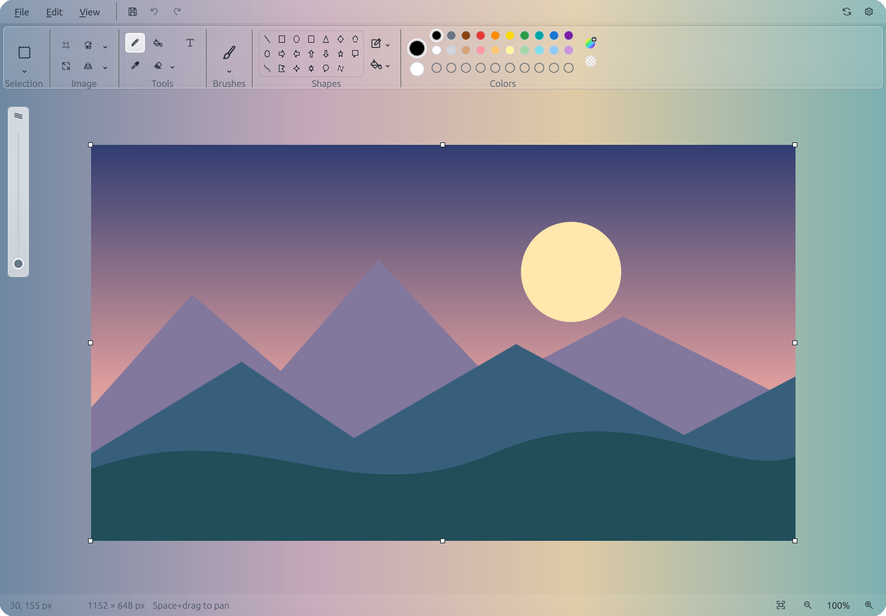
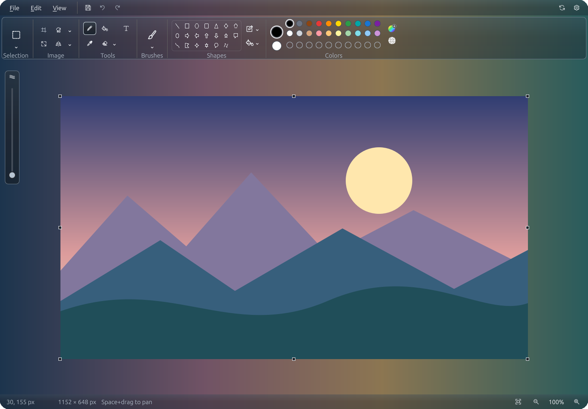

# OpenPaint

**A familiar paint app for Linux.**

Sketch, paint and make quick image edits with a clean desktop interface.
Free and open source. Editing works offline—no account or telemetry.

[**Download the latest release**](https://github.com/AfshinKI/openpaint/releases/latest) ·
[Installation guide](docs/INSTALL.md) ·
[Report an issue](https://github.com/AfshinKI/openpaint/issues)

## OpenPaint 1.3.0

Screenshots are cropped to the app window with rounded outer corners.

### Light mode

### Dark mode

*Captured from the OpenPaint v1.3.0 release UI with glass enabled at 40% surface
opacity, generated demo artwork and a staged original gradient backdrop. See [capture provenance](docs/assets/README.md).
The isolated capture harness uses generated artwork and a staged backdrop; it does not demonstrate desktop compositor blur. Unsupported glass configurations use opaque surfaces.*

## Make it yours

- Draw with brushes, pencil, fill, shapes, splines and mixed-font text.
- Select by rectangle, free-form outline or matching color; copy, move, crop, resize and rotate.
- Open and export PNG, JPEG, BMP and WebP. Save drawings as PNG.
- Undo and redo, zoom and pan, and switch between light and dark themes.
- Adjust supported glass appearance; native packages check for stable releases automatically.

## Install

Linux x86_64: choose the **Ubuntu 24.04 .deb** for app-menu integration,
**Flatpak** for other distributions, or the **portable archive**.
See the [installation guide](docs/INSTALL.md) for requirements, checksums and updates.

OpenPaint is a single-layer editor. Layers, editable project files, crash
recovery and automatic update installation are not included yet.

[Website source and publishing](website/README.md) ·
[Build from source](docs/BUILD.md) · [Contribute](CONTRIBUTING.md) ·
[Roadmap](docs/ROADMAP.md) · [GPL-3.0-or-later](LICENSE)

OpenPaint is an independent project, not affiliated with Microsoft.
