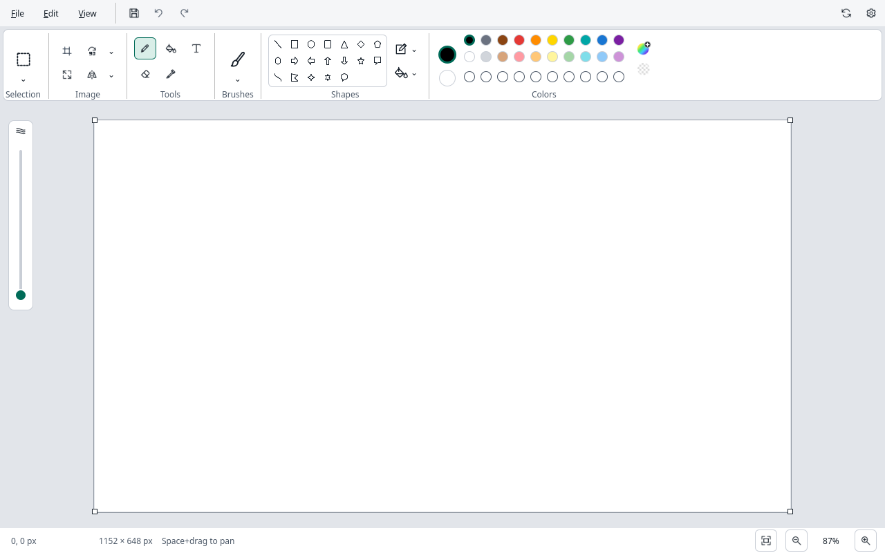

# OpenPaint

**A familiar paint app for Linux.**

Sketch, paint and make quick image edits with a clean desktop interface.
Free, open source and offline—no account or telemetry.

[**Download v1.0.0**](https://github.com/AfshinKI/openpaint/releases/tag/v1.0.0) ·
[Installation guide](docs/INSTALL.md) ·
[Report an issue](https://github.com/AfshinKI/openpaint/issues)

## Make it yours

- Draw with brushes, pencil, fill, shapes and text.
- Select, copy, move, crop, resize and rotate.
- Open and export PNG, JPEG, BMP and WebP. Save drawings as PNG.
- Undo and redo, zoom and pan, and switch between light and dark themes.

## Install

Linux x86_64: choose the **Ubuntu 24.04 .deb** for app-menu integration,
**Flatpak** for other distributions, or the **portable archive**.
See the [installation guide](docs/INSTALL.md) for requirements, checksums and updates.

Version 1.0.0 is a single-layer editor. Layers, editable project files, crash
recovery and automatic updates are not included yet.

[Build from source](docs/BUILD.md) · [Contribute](CONTRIBUTING.md) ·
[Roadmap](docs/ROADMAP.md) · [GPL-3.0-or-later](LICENSE)

OpenPaint is an independent project, not affiliated with Microsoft.
